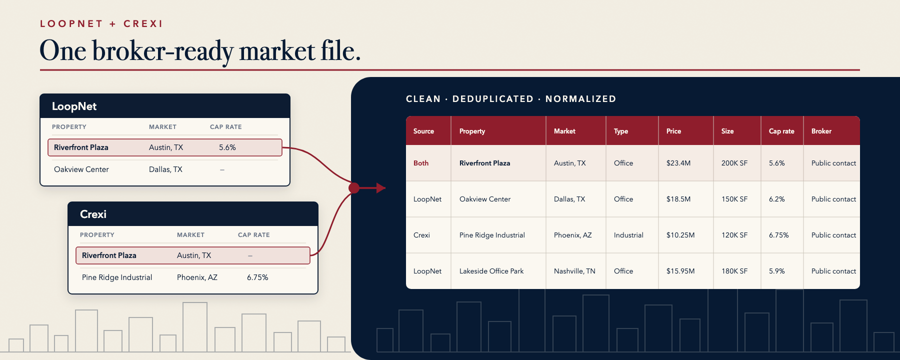

# LoopNet Scraper + Crexi Scraper API Examples for Commercial Real Estate

Run a **LoopNet scraper**, a **Crexi scraper**, or both sources together through one Apify Actor. These GitHub examples turn public commercial real estate listings into a clean dataset for market scans, broker research, underwriting prep, CRM enrichment, or daily monitoring.

[](https://apify.com/kazkn/commercial-real-estate-brokerage-intel?fpr=8fp2od)

[](https://apify.com/kazkn/commercial-real-estate-brokerage-intel?fpr=8fp2od)
[](https://youtu.be/TVAcUSzaS7w)
[](./examples/)
[](LICENSE)

> This repository contains public API examples, workflows, documentation, and sample output for the [Commercial Real Estate Brokerage Intel Apify Actor](https://apify.com/kazkn/commercial-real-estate-brokerage-intel?fpr=8fp2od). It does not contain the private Actor source code.

**Explore on Apify:** [Run Actor](https://apify.com/kazkn/commercial-real-estate-brokerage-intel?fpr=8fp2od) · [Input](https://apify.com/kazkn/commercial-real-estate-brokerage-intel/input-schema?fpr=8fp2od) · [Output](https://apify.com/kazkn/commercial-real-estate-brokerage-intel/output-schema?fpr=8fp2od) · [Pricing](https://apify.com/kazkn/commercial-real-estate-brokerage-intel/pricing?fpr=8fp2od) · [API](https://apify.com/kazkn/commercial-real-estate-brokerage-intel/api/python?fpr=8fp2od) · [Examples](https://apify.com/kazkn/commercial-real-estate-brokerage-intel/examples?fpr=8fp2od) · [Support](https://apify.com/kazkn/commercial-real-estate-brokerage-intel/issues/open?fpr=8fp2od)

## Why this exists

Commercial real estate teams often start research in two tabs: LoopNet and Crexi.

The manual workflow usually looks like this:

1. Search a market on LoopNet.
2. Repeat the same search on Crexi.
3. Copy listings into a spreadsheet.
4. Remove duplicate properties.
5. Normalize price, rent, cap rate, square footage, and days on market.
6. Find broker names and companies.
7. Rebuild the same file tomorrow.

The actor turns that into one API call.

It is not trying to replace every enterprise CRE platform. It is designed for the first-pass market file: a clean, exportable dataset that helps you move from "what is listed?" to "which deals should I inspect?" faster.

## What you get

| Need | Output |
|---|---|
| LoopNet listings data | Public LoopNet listing rows in a normalized schema |
| Crexi listings data | Public Crexi listing rows in the same schema |
| Commercial real estate API | JSON, CSV, Excel, Google Sheets, CRM, or database-ready records |
| Cross-platform deduplication | `is_cross_listed`, `also_listed_on`, and stable source IDs |
| Cap rate data API | A normalized `cap_rate` value when source data supports it, with unavailable values kept explicit |
| Days-on-market data | `days_on_market` when the source exposes usable date signals |
| CRE broker leads | Broker name, company, phone, and email when publicly exposed |
| Daily monitoring | Emit only newly seen listings for a saved market scan |
| Transaction tracking | Detect removed, sold, leased, or changed listings across runs |

## Quick start

### 1. Run on Apify

Open the actor:

[apify.com/kazkn/commercial-real-estate-brokerage-intel](https://apify.com/kazkn/commercial-real-estate-brokerage-intel?fpr=8fp2od)

Use this input for a quick Austin market scan:

```json
{
  "city": "Austin",
  "state": "TX",
  "sourcesEnabled": ["loopnet", "crexi"],
  "transactionTypes": ["sale"],
  "assetClasses": ["office", "retail"],
  "priceMin": 500000,
  "priceMax": 5000000,
  "maxResultsPerSource": 200,
  "deduplicate": true,
  "normalizeCapRate": true,
  "includeListingDetails": false
}
```

### 2. Export the dataset

After the run finishes, export from Apify Storage as:

- CSV for Excel or Google Sheets
- JSON for API workflows
- XLSX for spreadsheet review
- API dataset items for apps, CRMs, or warehouses

### 3. Enable broker enrichment when needed

For pure market scans, keep `includeListingDetails` disabled.

For broker lead research, enable it:

```json
{
  "city": "Dallas",
  "state": "TX",
  "sourcesEnabled": ["loopnet", "crexi"],
  "transactionTypes": ["sale"],
  "assetClasses": ["office", "industrial", "retail"],
  "maxResultsPerSource": 1000,
  "includeListingDetails": true
}
```

Listing detail enrichment is best-effort and only fills broker phone/email when the source publicly exposes those fields.

## API examples

This repo includes ready-to-use examples:

| File | Use case |
|---|---|
| [`examples/01-curl-quickstart.sh`](./examples/01-curl-quickstart.sh) | Trigger a run from the terminal |
| [`examples/02-python-market-scan.py`](./examples/02-python-market-scan.py) | Run a market scan and export CSV |
| [`examples/03-node-daily-monitoring.mjs`](./examples/03-node-daily-monitoring.mjs) | Schedule-style daily monitoring input |
| [`examples/04-google-sheets-export.py`](./examples/04-google-sheets-export.py) | Convert dataset items into a Sheets-ready CSV |
| [`examples/05-broker-lead-list.py`](./examples/05-broker-lead-list.py) | Build a broker outreach review file |

All examples read `APIFY_TOKEN` from the environment.

```bash
export APIFY_TOKEN=<YOUR_APIFY_TOKEN>
```

Get your token from [Apify Console](https://console.apify.com/account#/integrations).

## LoopNet scraper API example

Use the combined Actor as a LoopNet-only scraper by selecting only `loopnet`:

```json
{
  "city": "Austin",
  "state": "TX",
  "sourcesEnabled": ["loopnet"],
  "transactionTypes": ["sale"],
  "assetClasses": ["office"],
  "maxResultsPerSource": 100
}
```

You can also paste an official LoopNet search or listing URL into `startUrls`. In URL mode, the URL determines the source and search criteria, so manual location and filter fields are ignored.

## Crexi scraper API example

Use the same Actor as a Crexi-only scraper by selecting only `crexi`:

```json
{
  "city": "Miami",
  "state": "FL",
  "sourcesEnabled": ["crexi"],
  "transactionTypes": ["sale"],
  "assetClasses": ["retail"],
  "maxResultsPerSource": 100
}
```

Crexi is collected directly. You can also paste an official Crexi search or listing URL into `startUrls` to keep that page's source criteria.

## Python example

```python
from apify_client import ApifyClient

client = ApifyClient("YOUR_APIFY_TOKEN")

run = client.actor("kazkn/commercial-real-estate-brokerage-intel").call(run_input={
    "city": "Dallas",
    "state": "TX",
    "sourcesEnabled": ["loopnet", "crexi"],
    "transactionTypes": ["sale"],
    "assetClasses": ["office", "retail", "industrial"],
    "maxResultsPerSource": 500,
    "deduplicate": True,
    "normalizeCapRate": True,
    "includeListingDetails": False
})

items = client.dataset(run["defaultDatasetId"]).list_items().items
print(f"Fetched {len(items)} commercial real estate listings")
```

## Node.js example

```javascript
import { ApifyClient } from "apify-client";

const client = new ApifyClient({ token: process.env.APIFY_TOKEN });

const run = await client.actor("kazkn/commercial-real-estate-brokerage-intel").call({
  city: "Phoenix",
  state: "AZ",
  sourcesEnabled: ["loopnet", "crexi"],
  transactionTypes: ["sale"],
  assetClasses: ["office", "retail"],
  maxResultsPerSource: 250,
  deduplicate: true,
  normalizeCapRate: true,
});

const { items } = await client.dataset(run.defaultDatasetId).listItems();
console.log(items.slice(0, 5));
```

## Output fields

Typical dataset columns include:

| Field | Meaning |
|---|---|
| `source` | `loopnet` or `crexi` |
| `source_listing_id` | Source-specific listing ID |
| `listing_url` | Public listing URL |
| `transaction_type` | `sale` or `lease` |
| `address` | Source-exposed or normalized address text |
| `city`, `state`, `zip` | Location fields when available |
| `asset_class` | Office, retail, industrial, multifamily, land, hotel, mixed-use, specialty |
| `asking_price_or_rent` | Source display value for sale price or lease rent |
| `asking_amount_usd` | Comparable numeric amount when the source value is USD or conversion is proven |
| `building_size_sqft` | Building size in square feet when available |
| `cap_rate` | Source-listed value or a comparable rate calculated from source-declared NOI and asking price |
| `noi` | Source-declared NOI when public; `not public` otherwise |
| `days_on_market` | Days on market when a usable listing date exists |
| `broker_name` | Broker name when public |
| `broker_company` | Brokerage company when public |
| `broker_phone` | Broker phone when public |
| `broker_email` | Broker email when public |
| `also_listed_on` | Other source where the same property appears |
| `is_cross_listed` | Whether the property appears on both supported sources |

See [`sample-data/example-output.json`](./sample-data/example-output.json) and [`sample-data/dallas-market-file-sample.csv`](./sample-data/dallas-market-file-sample.csv) for example rows.
The fictional `cap_rate` and `noi` values illustrate only source-supported data; model-only estimates are not published as facts.

## Pricing examples

The actor uses pay-per-event pricing on Apify. Higher Apify plans receive lower unit prices:

| Event | Price from |
|---|---:|
| Actor start | From $0.05 per run |
| Result | From $5.00 per 1,000 returned listings |
| Listing detail enrichment | From $5.00 per 1,000 enriched listings |
| Monitoring mode | From $0.001 per enabled run |

See the Actor's live [Pricing tab](https://apify.com/kazkn/commercial-real-estate-brokerage-intel/pricing?fpr=8fp2od) for the exact price attached to your Apify plan.

## Practical workflows

### First-pass market file

Use the actor to create a quick market file for Dallas, Austin, Phoenix, Miami, Chicago, Los Angeles, or any other US city.

Recommended input:

```json
{
  "city": "Dallas",
  "state": "TX",
  "sourcesEnabled": ["loopnet", "crexi"],
  "transactionTypes": ["sale"],
  "assetClasses": ["office", "retail", "industrial"],
  "maxResultsPerSource": 1000,
  "deduplicate": true,
  "normalizeCapRate": true
}
```

### Broker lead research

Enable listing details to enrich the dataset with broker fields where public:

```json
{
  "city": "Austin",
  "state": "TX",
  "sourcesEnabled": ["loopnet", "crexi"],
  "transactionTypes": ["sale"],
  "assetClasses": ["office", "retail"],
  "maxResultsPerSource": 500,
  "includeListingDetails": true
}
```

### Daily CRE deal flow dashboard

Use `monitoringMode` on an Apify schedule:

```json
{
  "city": "Phoenix",
  "state": "AZ",
  "sourcesEnabled": ["loopnet", "crexi"],
  "transactionTypes": ["sale"],
  "assetClasses": ["office", "industrial"],
  "maxResultsPerSource": 1000,
  "monitoringMode": true
}
```

## Guides

- [How to deduplicate LoopNet and Crexi listings](./docs/deduplicating-loopnet-crexi-listings.md)
- [Build a daily CRE deal flow dashboard](./docs/build-daily-cre-deal-flow-dashboard.md)
- [Broker lead workflow from public CRE listings](./docs/broker-lead-workflow.md)
- [Cost, data quality, and what this actor is not](./docs/faq-cost-and-data-quality.md)

## Video demo

[](https://youtu.be/TVAcUSzaS7w)

Watch the demo: [LoopNet + Crexi to one clean commercial real estate dataset](https://youtu.be/TVAcUSzaS7w).

## Related links

- [Commercial Real Estate Brokerage Intel on Apify](https://apify.com/kazkn/commercial-real-estate-brokerage-intel?fpr=8fp2od)
- [Actor input schema](https://apify.com/kazkn/commercial-real-estate-brokerage-intel/input-schema?fpr=8fp2od)
- [Actor output schema](https://apify.com/kazkn/commercial-real-estate-brokerage-intel/output-schema?fpr=8fp2od)
- [Live pricing](https://apify.com/kazkn/commercial-real-estate-brokerage-intel/pricing?fpr=8fp2od)
- [Python API documentation](https://apify.com/kazkn/commercial-real-estate-brokerage-intel/api/python?fpr=8fp2od)
- [Ready-made Actor examples](https://apify.com/kazkn/commercial-real-estate-brokerage-intel/examples?fpr=8fp2od)
- [Actor support and issues](https://apify.com/kazkn/commercial-real-estate-brokerage-intel/issues/open?fpr=8fp2od)
- [Apify platform](https://www.apify.com?fpr=8fp2od)
- [LoopNet](https://www.loopnet.com)
- [Crexi](https://www.crexi.com)
- [KazKN on Apify](https://apify.com/kazkn)

## FAQ

### Is this a CoStar replacement?

No. It is better to position it as a lightweight first-pass market-file workflow. It helps you collect, normalize, export, and monitor public on-market listings from LoopNet and Crexi. It does not replace every proprietary research, comp, ownership, lease, or analytics feature in an enterprise CRE platform.

### Does it return broker emails and phones?

Only when the source publicly exposes them. The actor never invents broker contacts. Rows keep unavailable broker fields explicit so users can see what was publicly discoverable.

### Can I use this as a commercial real estate API?

Yes. You can run it through Apify API, Python, Node.js, cURL, Apify schedules, webhooks, Make, Zapier, Google Sheets, Airtable, or your own backend.

### Can I run both LoopNet and Crexi in the same job?

Yes. Set `sourcesEnabled` to `["loopnet", "crexi"]`. If both sources expose enough listings, `maxResultsPerSource: 1000` can return up to 1,000 LoopNet rows plus 1,000 Crexi rows before deduplication.

### Is the data always complete?

No public listing source is perfectly complete. Some rows are search-only, some are detail-enriched, and some broker contact fields are blocked or not exposed. The actor is designed to return the maximum usable dataset without pretending unavailable fields exist.

## Support

- Open an issue in this repo for integration examples, feature requests, or documentation gaps.
- Open an [issue on Apify](https://apify.com/kazkn/commercial-real-estate-brokerage-intel/issues/open?fpr=8fp2od) for Actor runs, source behavior, or product support.
- Run the actor on Apify: [commercial-real-estate-brokerage-intel](https://apify.com/kazkn/commercial-real-estate-brokerage-intel?fpr=8fp2od)

Built by [KazKN](https://apify.com/kazkn).
